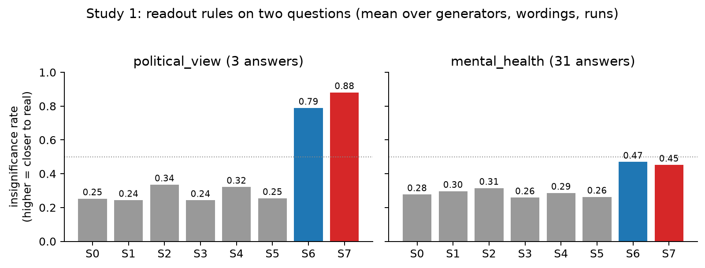
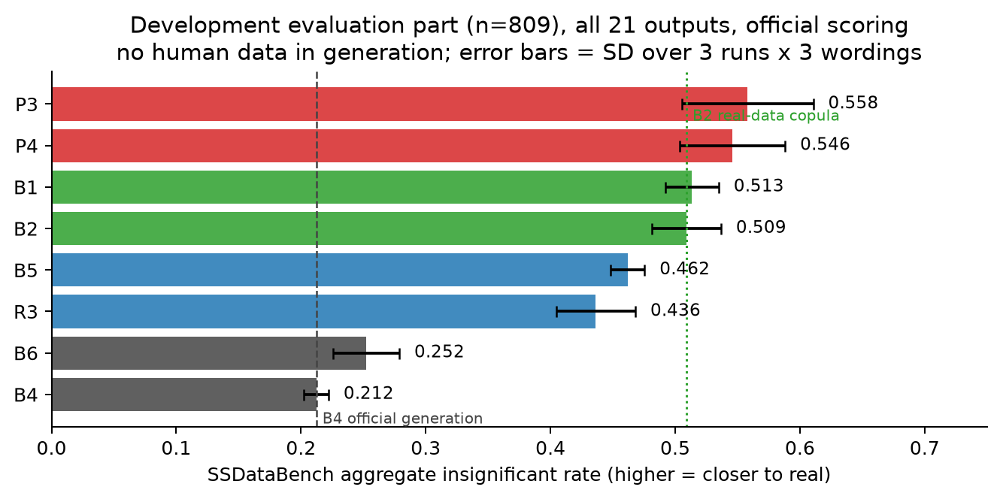
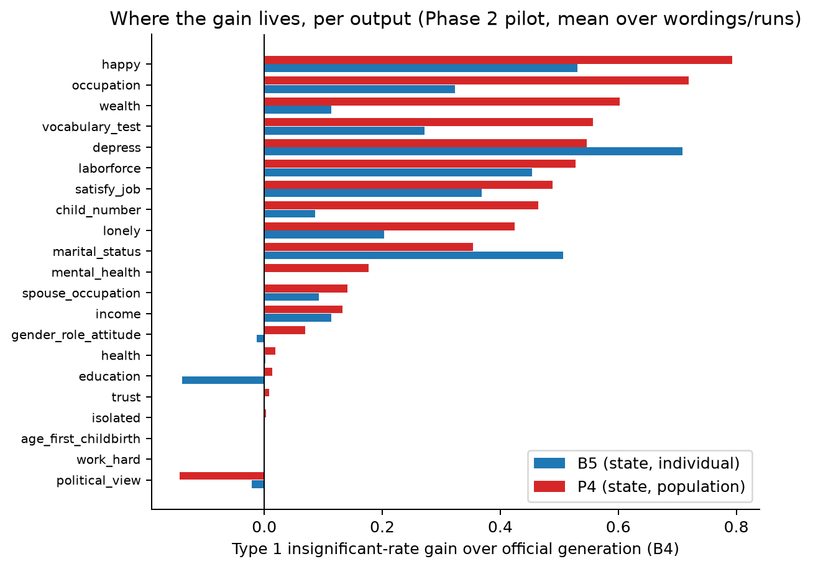
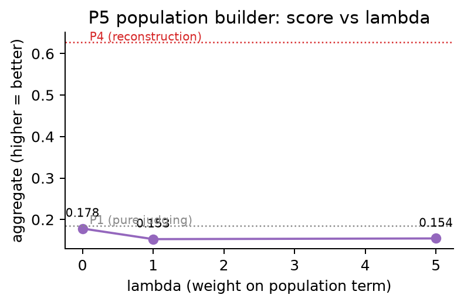
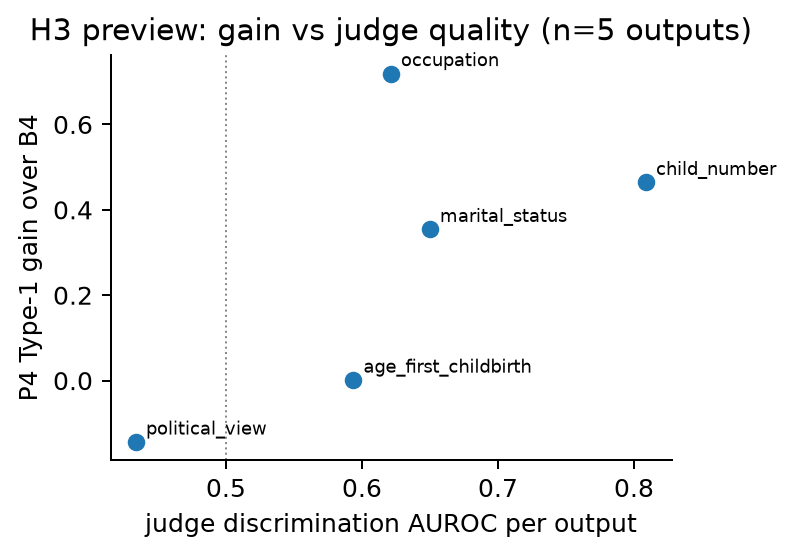

# Results so far — LLM as reviewer on SSDataBench (GSS 2018)

**One-line claim:** a model knows far more about a population than its generated
answers reveal — and *asking it to state distributions* recovers that knowledge,
while *asking it to judge candidates* does not, for identifiable reasons.

All results: development respondents only (the benchmark's final test sample is
untouched), official SSDataBench scoring throughout (Types 1–3, B = 100,
α = 0.05, n = 500, seed-patched), no human data anywhere in generation.
Test model / judge: `google/gemini-2.5-flash`. Aggregate = mean insignificant
rate (higher = closer to real).

---

## 1. The premise: stating beats generating (H0 ✓)

Study 1, two questions, eight readout rules. Drawing answers from the model's
*stated distribution* (S6) or from *stated population tables* (S7) beats
sampling its generations (S0) decisively — political_view 0.79–0.91 vs
0.20–0.31, with within-group spread recovering to 1.00 (generation: 0.89) and
stereotype-inflated associations dropping to ~0 (generation: +0.07 to +0.12).

## 2. The main result: population-level stating beats real-data references

Phase 3, all 21 outputs, 809 development respondents, every call redone per run.

| method | aggregate | what it is |
| --- | --- | --- |
| **P3** | **0.558** | candidates drawn from stated tables; judge picks (adds ≈ nothing) |
| **P4** | **0.546** | stated two-way tables → log-linear marginals + copula |
| B1 | 0.513 | *marginals fitted on real respondents* |
| B2 | 0.509 | *Gaussian copula fitted on real respondents* |
| B5 / R3 | 0.462 / 0.436 | individual-level stating |
| B4 | 0.212 | official generation (the benchmark's own method) |

**P3/P4 use no human data and beat references fitted on real data.** The gain
over B4 (+0.33) is ~16× the between-run SD. Wording spread (W1 0.60 → W3 0.51
for P3) is real and reported; the sign of every method-vs-B4 comparison is
stable under all wordings.

## 3. Where the gain lives (and where it doesn't)

P4 recovers outputs where official generation scores absolute zero: happy
+0.79, occupation +0.72, wealth +0.60, vocabulary_test +0.56. A stubborn
residual remains (work_hard, age_first_childbirth, isolated, trust, health,
education ≈ 0 gain) — genuine knowledge gaps that no readout fixes.
Curiosity: B4's political_view marginal is already fine (0.86) in full-profile
generation, though one-question generation collapses it.

## 4. Judging fails — and Study 3 explains exactly why

No judging method separates from its random-pick contrast (P1 vs P1-random:
±0.02; P2 vs P2-random: ±0.01; P3 vs P4: ±0.01–0.04, all within noise), and
P5's population term makes things *worse* as λ grows (0.178 → 0.154).

The judge's profile (Study 3, gates fixed before running):

| capacity | result | gate |
| --- | --- | --- |
| detect a swapped answer (discrimination) | AUROC 0.587 ≈ GBM-on-real-data 0.589 | ≥ 0.578 ✅ |
| probabilities track a reference model (calibration) | slope 0.31 (flat) | 0.5–1.5 ❌ |
| resist the typicality trap | 41% (prefers the stereotype) | > 50% ❌ |

So: the knowledge exists (discrimination passes), but the judge's probabilities
are too flat to rank candidates, and it *shares generation's stereotypes* — it
prefers the same wrong answers generation produces. Study 1 adds the third
mechanism: candidates span only 2 of 3 (or 3 of 31) answers, so reweighting
cannot restore the missing mass.

(H3 preview: per-output gain tracks judge discrimination, ρ = 0.70 on the 5
outputs measured so far; Phase 4 measures all 21.)

## 5. What this means

- **For the benchmark's claim** (generation compresses variation): confirmed,
  and localized — compression is worst exactly where stating recovers most.
- **For the design space**: the readout *form* (state vs judge vs sample) moves
  the score by +0.35; the *level* (population vs individual) by +0.09; judge
  vs random by ~0. Readout form matters more than anything else we varied.
- **For practice**: synthetic survey data from an LLM becomes substantially
  more realistic by changing *how the model is asked* — no training, no human
  data, same model, same benchmark scoring.
- **For self-improvement narratives**: a model that can *detect* bad answers
  (AUROC ≈ a real-data classifier) still cannot *rank* its own candidates —
  the generation–verification gap has an intra-model structure.

## What remains (Phase 4)

Final test on the untouched 1,000-row benchmark sample: B4 reproduction check
against the paper's published gemini-2.5-flash score, P3 + P4 + B5 + references
at the sized run count, H1–H4 verdicts with intervals, wording robustness, and
a second model. Cost ≈ $100–150; ~$14 credit remains.
