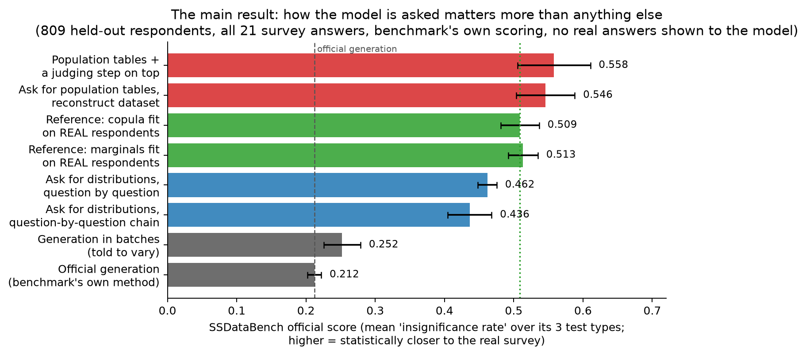
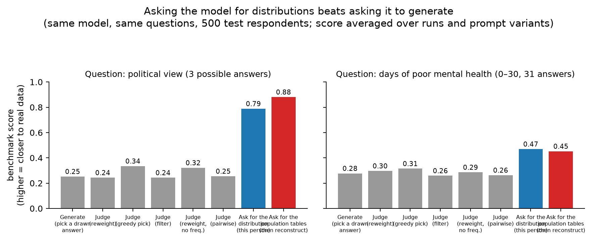
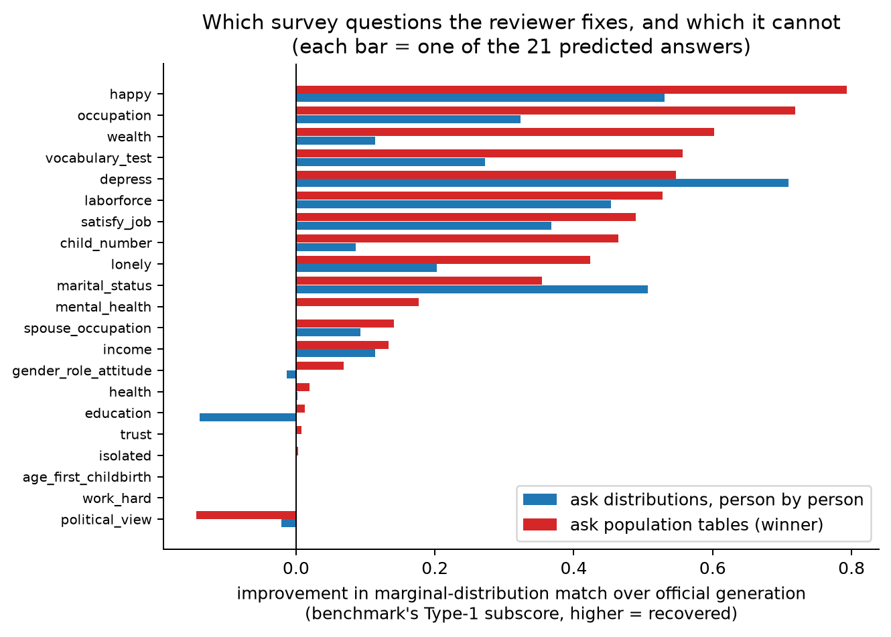

# Can an LLM produce more realistic synthetic survey data as a reviewer than as a generator?

**Result summary — self-contained; no other document needed to read this.**

---

## 1. The question

SSDataBench (Xie et al.) is a benchmark that tests whether LLM-generated
"synthetic respondents" reproduce the statistical patterns of a real survey. It
gives the model each real respondent's background (age, sex, race, parents'
education and occupation, …), asks it to *generate* that person's 21 remaining
answers (marital status, income, health, attitudes, …), and then compares the
synthetic dataset against the real one with significance tests. The finding the
benchmark is known for: generated data **compress** real variation — the model
mostly outputs the "typical" answer for each person, so the synthetic
population is too homogeneous.

This project asks a simple question: **the same model, the same benchmark, the
same scoring — but instead of asking the model to *generate* answers, we ask it
to *review* its knowledge of the population. Does that beat generation?**

Two flavors of "reviewing" are tested:

- **Judging**: show the model candidate answers (or whole candidate profiles)
  and ask which a real respondent would more likely give.
- **Stating**: ask the model directly for the *probability of every possible
  answer* — for one person ("what fraction of people like this answer X?") or
  for whole population groups ("among women aged 35–54, what share answered
  X?") — and build the synthetic dataset from those stated distributions.

## 2. How to read the numbers

Every score below is **the benchmark's own official score**: the share of its
bootstrap significance tests (univariate distributions, pairwise associations,
and regression structure; B = 100 resamples, α = 0.05, 500 rows per draw) in
which synthetic and real data are statistically indistinguishable. **Higher =
more realistic.** 1.0 would mean indistinguishable from real on every test.
Nothing about the scoring was changed except seeding its random generator so
results are reproducible.

Three facts about the setup that matter for trusting the comparison:

1. **No real answers are ever shown to any method.** Every method sees only
   what the benchmark's own generation sees: one respondent's background.
   Real answers are used only by the benchmark's scorer, after generation.
2. All results here are on **held-out respondents** the benchmark never uses
   for evaluation (809 of them; a separate 539 fit our reference models). The
   benchmark's actual test sample is untouched, saved for the final run.
3. Same model throughout: `gemini-2.5-flash` (one of the models the benchmark's
   authors tested), temperature 1.0, no tuning, no training.

## 3. The main result

Reading the bars top to bottom:

- **Official generation** (the benchmark's own method, reproduced by us):
  **0.21**. This is the baseline the benchmark's paper reports as weak.
- **Generation in batches** ("write 10 varied people at once"): 0.25 — barely
  moves.
- **Stating, person by person** (for each of the 21 questions, ask "what is
  the probability of each answer for this person?", then draw): **0.46**.
- **Stating, as an analyst** (the winner): for every question × every
  background group, ask "what share gave each answer?", fit those stated
  tables into a coherent joint model, and draw the synthetic population from
  it: **0.55**, or 0.60 under the best of three pre-registered prompt
  wordings.
- **References** — what you get by fitting the same kind of statistical model
  *on the real respondents' answers*: 0.51 (marginals only) and 0.51
  (full Gaussian copula). These use human data; our methods do not.

**Conclusion 1: yes — the reviewer beats the generator, by a lot.** +0.34 on
the benchmark's own score, roughly 16× the run-to-run noise. And the best
reviewer **beats references fitted on real data while using none**.

**Conclusion 2: the win comes from stating, not judging.** Adding a judging
step on top of the stated tables changed the score by ~0.01 (noise). Pure
judging methods (rank candidate answers) never beat picking randomly from the
same candidates. The next sections explain why.

## 4. The premise, at one-question scale

Before running all 21 questions we ran one question at a time (500 respondents,
two questions shown below), comparing eight ways of producing one answer:

Grey = generation and the five judging variants; blue/red = the two stating
variants. For the 31-answer mental-health question, generation and every
judging rule score ~0.13–0.17 (essentially never match the real distribution),
while population-level stating reaches 0.43–0.47. Asking for the distribution
also restores the *spread* of answers within groups to the real level (ratio
1.00 vs 0.89 for generation) and removes generation's tendency to over-associate
answers with backgrounds (stereotype inflation falls from +0.07–0.12 to ~0).

## 5. Where the gain lives — and where it doesn't

The reviewer's improvement is not uniform. It completely rescues answers where
generation fails absolutely (happiness: generation matches the real
distribution in ~0% of tests → ~0.79 after stating; occupation 0 → 0.72;
wealth 0 → 0.60; vocabulary 0 → 0.56). But some answers stay broken under every
method (importance of hard work, age at first childbirth, feeling isolated,
trust): these look like genuine knowledge gaps — the model mis-states those
distributions however it is asked.

## 6. Why judging fails (we measured the judge directly)

We ran six diagnostic tests on the judge, with pass thresholds fixed in
advance:

| Test | Result | Verdict |
| --- | --- | --- |
| Show a real profile and a copy with one answer swapped: can the model tell which is real? | 0.587 AUROC — **as good as a gradient-boosting classifier trained on the real data** (0.589) | passes |
| Do its stated probabilities track a reference model fit on real data? | slope 0.31 — nearly flat | fails |
| When the model's generation prefers an answer that is actually uncommon, does the judge correct it? | 41% — **it prefers the same wrong answer** | fails |

So the model *knows* which profile is real (discrimination is fine) but its
probabilities are too flat to rank candidates, and it shares generation's
stereotypes — judging cannot fix errors it would make itself. A third
mechanism: candidates from generation cover only a sliver of the answer space
(10 draws span 2 of 3 political-view answers; 3 of 31 mental-health answers),
so no reweighting can restore the missing mass. The failure profile is the
paper's mechanism story: *knowledge is present, generation ignores it, and
only distribution-level readouts extract it.*

## 7. Caveats (honest ones)

- **Prompt wording matters**: the winner scores 0.60 / 0.56 / 0.51 under the
  three pre-registered wordings. All wording variants beat generation; the
  spread is reported, not hidden — and the benchmark's own prompt is itself a
  wording choice.
- All results are on development respondents; the formal final test on the
  benchmark's untouched evaluation sample (with a reproduction check against
  the paper's published score for this model, plus a second model family) is
  the remaining step.
- One anomaly worth knowing: generation already matches the political-view
  marginal (0.86) when all 21 questions are asked in one prompt, but collapses
  it (0.03) when asked one question at a time — prompt structure, not just
  form, modulates compression.

## 8. Bottom line

**Same model, same benchmark, same scoring. Asking the model to state
population distributions instead of generating personas raises the official
score from 0.21 to 0.55–0.60 — past models fitted on real data. Asking it to
judge candidate answers adds nothing, for measured reasons.** Readout form
matters more than model choice.
